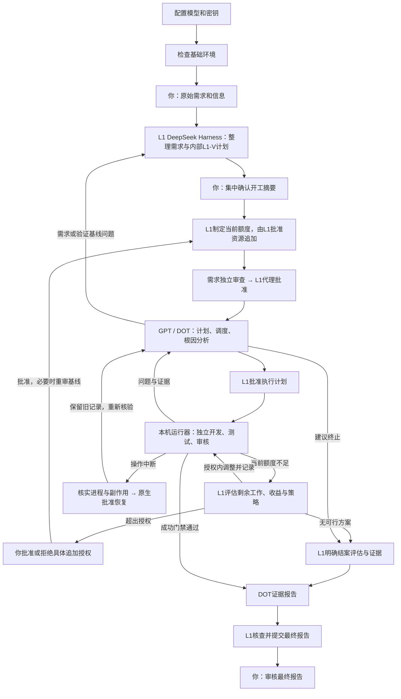

# ReqPilot · 需求领航


**从需求沟通到独立开发、测试与审核，由 L1 引导、GPT/DOT 统筹，最终提交有证据的报告。**

原项目名 AI-Programming-Workflow。[名称、图标与升级兼容说明](docs/guides/branding.md)。

**你向L1提供原始需求、参数和环境，并在开工前集中确认一次边界。L1生成、独立审查并批准需求与执行计划，通过GPT API调用DOT组织开发、测试、审核，最后由L1提交成功或失败报告给你审核。** 当前版本 **3.19.2**。下载与更新说明见[最新正式发布](https://github.com/Merrychen-CMY/ReqPilot/releases/latest)。

默认顺序：**配置模型和密钥 → 检查环境 → 沟通原始需求 → 集中确认开工 → L1 自动推进 → 用户审核最终报告**。



## 从这里开始

| 文件 | 用途 |
| --- | --- |
| [AGENTS.md](AGENTS.md) | Agent共同规则与审批边界 |
| [L1.md](L1.md) | 唯一用户入口、代理审批和最终报告 |
| [DOT.md](DOT.md) | GPT/DOT调度、独立执行与回流 |
| [L1插件使用指南](docs/guides/l1-plugin.md) | 安装、配置向导、环境检查与一次开工确认 |
| [MCP工具桥指南](docs/guides/l1-harness.md) | 手动集成与终端审核后备方式 |
| [首次跑通](docs/guides/first-run.md) | 从小任务验证完整流程 |
| [模板](templates/README.md) | 由L1/DOT维护的需求、计划、委托和报告 |

中间审批由L1完成，范围内变更也回L1。你确认目标、权限和明确截止时间；L1制定资源额度并自行批准追加。达到当前额度先由L1评估；超出授权时向你申请具体变更。非成功结案须由L1明确评估，并有无可行方案、用户原生确认停止或实际触达且不可调整的全任务上限作为依据。最终报告列出调整理由、实际消耗及结果，不能清零历史或无限重试。用户无需另外操作DOT或维护内部清单。

## 已实现与接入限制

3.16.0为L2/DOT接通直接文件读写/编辑、目录、命令、网页抓取与搜索工具；规划和根因分析可自行查资料，也可委派Codex调查。每次操作保存证据，工具调用结果按call_id返回GPT，搜索计入同一API账本。直接命令沿用当前用户进程权限，并非OS沙箱；能力不授予需求批准、产品实现或独立验收权。具体工具、边界与升级方式见[能力指南](docs/guides/agent-capabilities.md)。

3.13.0将需求审核、计划审核和最终报告保存为Markdown文件，并在当前Harness聊天中交付文件卡；L1同时给出简要结论和可打开链接。执行约束固化于AGENTS.md并注入DOT及Codex派工：先定范围、最小改动、只读请求不改代码不跑测试、非验收问题只报告。独立Codex执行改用App Server保持双向通信，连续120秒无可见工作进展时在原会话问“你正在做什么？”，要求公开进度、阻碍和最小下一步；已在运行的构建或测试不误判。问询不延长原超时、不重放任务。详见[执行范围与报告交付](docs/guides/execution-scope.md)。

本版需要安装ABI12主包以启用聊天文件交付，并要求Codex支持App Server；安装后已开工任务仍固定原版，须按原生升级流程迁移。验证覆盖本地协议进程、报告文件及模拟Harness服务，未用真实模型或实际Harness聊天验证产品任务。

仓库实现了本地MCP stdio工具桥、OpenAI Responses API计划/调度/根因分析适配、独立Codex会话、L1代理审批、候选与证据校验、累计预算和最终人工报告门禁。GPT模型需在本机显式配置，API密钥仅从桥进程环境读取，不写入仓库或发给工作会话。

3.2.0增加同一任务内的NEEDS_INFO澄清、追加事实和重新规划；原授权、确认及累计消耗不变，新基线须独立审查。提供可安装的DeepSeek Harness原生插件包，添加“ReqPilot · 需求领航”专用入口。插件引导用户在本机配置页输入密钥，通过宿主凭据服务保存；用户主动完成两项API兼容性探测后，L1先独立检查基础环境，通过后才进行九项需求沟通；需求明确后复核项目特有环境，再用原生提问集中确认开工。后续中间审批仍由L1完成，最终报告也可在同一会话由用户审核。旧MCP工具桥继续作为手动接入方式。

3.2.2将完整计划的纯校验拒绝改为可修正的PLAN_REJECTED，保留诊断、API和时间消耗。实现预算明确为全任务初次与修复的累计L3派工数；构建、Doxygen、HIL与独立审核保留在验证部分。真实中断及旧版锁定任务不会自动解锁，详见[计划拒绝指南](docs/guides/plan-rejections.md)。

插件源码接口已按本机DeepSeek Harness 0.2.2-rc.3核对，并有配置页、管道和拒绝测试；尚未宣称已安装进你的真实Harness会话，也未用真实API密钥完成完整产品任务。自检和模拟通过不等于产品/HIL验收通过。详见[3.9.0验证记录](docs/reports/3.9.0-validation.md)。

本机审批记录不是受信签名服务；测试命令执行器不是OS沙箱，独立会话也不等于同账户安全隔离。现有分支/设备/部署保护照常保留。没有外部交付执行器，不自动合并、发布或刷写。

## 保留的规范与技术内容

双L1职责（Product L1与内部L1-V）、L2～L5、21章技术参考、16类L4/12类L5回流、48项正式系统拒绝场景均保留；默认中间批准主体改为L1，最终报告仍由用户审核。

嵌入式C使用 [华为项目规范V1.3](standards/embedded-c/README.md)：145父项、50子项、33条汇总规则及18章原技术内容。注释按 [Doxygen采用清单](standards/embedded-c/v1.3/doxygen/README.md) 的12项/33子项执行；冲突以华为为准。真实Doxygen检查入口保留，工具通过不代替语义审查或产品验收。

```powershell
python scripts/validate_repo.py
python -m unittest discover -s tests -v
```

以上验证仓库及运行器，不证明产品/HIL合规。版本历史见 [CHANGELOG](CHANGELOG.md)，按需导航见 [START_HERE](START_HERE.md)。

编程规范新增[通用编程与交付约束](standards/embedded-c/v1.3/project-constraints/README.md)：完整追踪用户材料U01～U26，并将适用范围推广至新项目的自有C/H。华为优先，Doxygen保留；规范摘要及独立审查接入运行器，源码语义仍需实际验证。

本次约束整合的检查范围见[3.0.1验证记录](docs/reports/3.0.1-validation.md)。

L1与DOT默认采用[合作沟通约束](docs/guides/l1-dot-communication.md)：信息足够、事实有据、聚焦任务、表达清楚。已接入现有API和L1工具桥提示，不增加工具或审批回合；尚未量化效率收益。

L1面向你的需求沟通与最终报告已加入[选择性表达规则](docs/guides/l1-user-expression.md)：结论优先、减少套话、保留异议和事实、分层呈现。有条件借鉴anti-defensive-writing并固定来源与MIT许可，排除更换评价口径、隐藏失败等不适用规则；不增加插件、模型调用或人工审批。接入和检查范围见[3.0.3验证记录](docs/reports/3.0.3-validation.md)，实际沟通效果尚未量化。

3.3.0新增[动态资源管理与追加授权](docs/guides/adaptive-resources.md)：新任务由用户确认总边界，L1分配当前额度；额度耗尽先由L1评估并批准资源追加；改变目标和操作权限另需用户决定。完整调整历史进入最终报告。旧任务不自动迁移，UNKNOWN与最终报告不自动解锁；本版仍没有统一货币硬上限。

3.4.1增加[自动更新](docs/guides/automatic-updates.md)：安装一次带更新器的版本后，默认在工作流活动时每6小时检查正式发布；私有仓库复用本机GitHub登录，凭据不进入模型或日志。未开工会话可无重启采用兼容新版；已确认任务默认保留原运行版本和完整记录；3.5.0可另行原生确认迁移。新工具或宿主接口变化仍需升级安装包。安装包见[正式发布下载](https://github.com/Merrychen-CMY/ReqPilot/releases/latest)。

3.5.0新增[已开工任务原对话升级](docs/guides/task-upgrades.md)：一次升级入口安装后，兼容任务可预检、原生确认并在同一对话继续；累计消耗和证据保留，重新独立审核与验证。UNKNOWN、终态和运行中操作不通过升级解锁。

3.6.0修复Windows长路径快照失败，并新增[初始化中断恢复](docs/guides/initialization-recovery.md)：保留部分快照与API用量，原生批准后恢复原任务；基线变化须明确接受并重新规划审核。需更新安装ABI4入口，产品UNKNOWN/终态不在恢复范围。

L1进度汇报采用[固定六字段模板](templates/l1-progress.md)：类型、时间、进度、需要你、不回复会怎样、详情。六个抬头独立展示，时间取实际汇报时刻；没有用户动作就明确无需回复，待授权工作不会因未回复而执行。

3.7.0增加[API异常评估与受控恢复](docs/guides/api-recovery.md)：L1调整等待和评估诊断；未知请求需用户原生批准后才能发起新请求，保留原记录。需安装ABI5入口，旧已结案或中断任务不自动恢复。

3.8.0修复[正常开工链路](docs/guides/normal-start.md)：审查证据自动随包、最新问题优先返回、完整记录分页、普通审批拒绝不锁任务。新增只读工具需安装ABI6宿主。验证层次及尚未完成的真实Harness/产品验证见版本验证记录，不以自动测试替代实际可用性证明。

3.9.0修复材料超限回流，并取消尚未查明原因时的自动结案：L2持续调查，L1协调资料、权限和资源；完整记录保留，未发送请求不计API次数。保留ABI6。详见[调查处理](docs/guides/investigation.md)，不自动重开已有最终报告。

3.10.0 增加[非成功结案门禁](docs/guides/l1-closure.md)：L2 先分析方案，所有自动失败出口转为暂停并交 L1 评估；只有完整 L1 结案评估才生成非成功最终报告。结构校验不证明方案正确，真实产品验证另计。

3.11.0补齐[流程图与恢复链路](docs/guides/flow-recovery.md)：需求先审后规划，暂停可继续调查与L1决策，修订保留不受影响的实现，真实中断经原生核实恢复，开工前后报告统一由L1提交。新增工具需安装ABI7主包；新原生任务强制动态额度，历史授权与实际消耗不重置。

3.13.0进一步修复完整工作流审核中的七项缺口：绑定实际被测源码与产物、逐项拦截必需测试缺失/跳过、独立测试允许隔离产物写入、原额度内重规划、当前版本初始化恢复、完整初始化提交，以及纯参数拒绝不制造UNKNOWN。L2完整方案交接和已批准本地设施恢复同时补齐。使用前阅读[候选测试契约与设施恢复](docs/guides/verification-contract.md)。

3.13.3修复真实开工前审核中断：所有审核返回副本都压缩历史；DOT直接接收当前需求批准与原生额度变更依据；已完成只读审核提供经原生确认的恢复路径。审核Markdown不再重复嵌入整段运行日志。旧任务使用新恢复路由须安装主插件包、重新加载插件，再按[恢复与升级说明](docs/guides/flow-recovery.md)操作；原任务历史和累计消耗保留。


3.14.0能力与资源规则：L1/L2/L3/L4/L5具备同等完整工具能力，以职责和当前任务限制行为。规划前可用dot_research收集网页、文件和环境证据，DOT可直接请求调查；普通技术查证不计需求修订或实现派工。资源追加由L1评估并自主批准，不再要求用户审批资源上限；目标、验收、操作范围和用户明确截止时间不因此改变。新任务默认采用，旧任务经明确展示此变更的原生升级后采用；保留原始确认和全部累计消耗。详见[能力与资源规则](docs/guides/agent-capabilities.md)。

3.15.0原生能力：L1拥有文件/目录操作、图片、补丁、搜索、命令、网页、后台任务、技能、子智能体协作、文档处理、展示和宿主管理等工具。命令执行不限定为版本查询，按当前职责和授权执行。先检查真实工具和调用结果，不以L1角色为由拒绝可自行完成的排查。见[能力指南](docs/guides/agent-capabilities.md)。


3.17.0 L2完整宿主能力：在Harness中，DOT通过host_tools动态发现当前会话实际可用的工具，再由host_call经过宿主原生权限管道执行。文件/目录/补丁、图片、网页、命令、后台任务、技能、子智能体及通信、工作流、文档/展示、待办/目标/定时和宿主管理不再按L2角色删减。仅ReqPilot控制及L1审批身份入口不供递归调用；工具能力不改变职责、授权范围和独立证据要求。后台工作须记录ID、查询结果并在依赖执行或结案前收敛；缺资料/环境主动排查并向L1提交具体完善建议。需要安装ABI11主包，已开工任务仍须原生升级。详见[能力指南](docs/guides/agent-capabilities.md)。


3.18.0 加密环境：按[加密环境兼容与恢复](docs/guides/encrypted-environment.md)处理所有受影响文件，不限定示例路径。L2核实允许的读取程序、真实消费者及保存失败，L1评估恢复；保留完整摘要、原任务、临时证据和消耗，不关闭加密策略、不自动重放或最终结案。安装ABI12主包后先调用workflow_updates(action="diagnose")；未决操作先原生恢复，再升级。

3.19.1 协作恢复：L2 先在授权内查资料、查环境并处理可纠正的草案问题，不能只把问题转交 L1；L1 负责主动组织恢复、完善并批准基线及资源。规划调查材料、历史额度变更和工具输出自动生成有界视图，完整原件保存在控制目录，DOT 通过 read_evidence 按摘要绑定分页读取。材料超限时 L1 必须查看 component_bytes / planning_component_bytes，消除重复日志、历史转述和无关附件，保留当前事实及原件引用；保留原件不等于每次全量发送。若精简已批准需求，逐项核对目标、硬约束、AC 和权限后重新独立审核及 L1 批准，不直接更改基线绕过检查，不要求用户代为整理。纯计划格式/校验错误由 L2 在同一次 dot_plan 内最多纠正一次，仍计 API 和时间；资源不足直接由 L1 评估，未决操作不重放。再次失败须带证据和具体方案交 L1，不能直接结案。详见[调查与材料处理](docs/guides/investigation.md)。

3.19.2：所有层级按[执行范围与排障规则](docs/guides/execution-scope.md)主动处理本次授权内的阻塞，无法解决时提交已尝试动作、证据和具体方案。已接入L1提示、DOT API和独立执行会话提示；沿用既有控制器恢复入口，不扩大职责或增加通用重试器。
