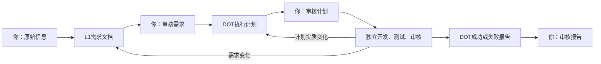

# AI自动编程流程：需求审核 → 计划审核 → 报告审核

**你描述原始需求、参数与环境，L1整理需求；你审核后，DOT提供执行计划供你审核，再组织独立开发、测试和审核，最后提交成功或失败报告供你审核。** 当前版本 **2.4.2**。



## 从这里开始

| 文件 | 用途 |
| --- | --- |
| [AGENTS.md](AGENTS.md) | Agent共同入口和审批边界 |
| [L1.md](L1.md) / [需求模板](templates/requirements.md) | 把原始信息整理成需求、约束和验收目标 |
| [DOT.md](DOT.md) / [执行计划](templates/execution-plan.md) | 方案、任务、独立分工、预算与回流 |
| [最终报告](templates/final-report.md) | 成功、失败或未完成结果及证据，交用户审核 |
| [本地运行器](docs/guides/local-runtime.md) | `scripts/dot.py` 的初始化、三次审核、运行和状态查询 |

用户不填写内部JSON或逐条规范清单，也不逐次审批普通修复。DOT在已批准需求和计划范围内推进；所有问题先由DOT分析根因再调度。需求/AC变化返回L1重审，已审计划实质变化重审计划，预算不因重启或改计划清零。

开发、独立测试和独立审核使用三个独立执行会话。冻结候选后检查真实结果；修复生成新候选，不复制旧PASS。重试耗尽必须停下提交报告，确认失败报告不自动授权继续。

成功报告经审核后进入DELIVERY_READY；合并/发布/部署/生产刷写仍分别核对授权与真实回执。本地运行器没有外部交付执行器，不会自动置DELIVERED。

## 实际能力

仓库包含可运行的本地DOT入口与流程自检，需要真实Codex和项目检查配置。终端审批相信当前本地账户及未被篡改的运行目录，摘要不是签名；独立会话不是操作系统权限隔离，Agent不得替用户输入批准。受信审批服务、产品/HIL测试结果、外部交付服务没有因仓库安装而自动获得。正式接入见 [适用范围](docs/advanced-profile.md)。

本版运行器的回归测试已通过；真实Codex试运行受本机Windows沙箱初始化故障阻断，尚未完成三会话端到端验证。具体结果和恢复条件见 [2.4.0验证记录](docs/reports/2.4.0-validation.md)。本次华为细则补齐和子项门禁验证见 [2.4.1修订记录](docs/reports/2.4.1-huawei-corrections.md)。

原双L1、L2～L5、21章技术参考、16类L4/12类L5回流矩阵及48项真实系统拒绝测试保留；详细流程也必须满足三次用户审核。导航见 [START_HERE](START_HERE.md) 和 [INDEX](INDEX.json)。

## 编码规范

嵌入式C采用 [华为参考的项目规范V1.3](standards/embedded-c/README.md) 与Doxygen：33条汇总规则、18个章节、139条原文编号要求及6项治理补充，按适用性记录证据和批准差异。阅读覆盖清单不等于产品已经合规，具体代码仍须检查。

## 仓库检查

```powershell
python scripts/validate_repo.py
python -m unittest discover -s tests -v
```

检查仓库一致性、策略反例和运行器行为，不执行真实产品/HIL验收。48项正式系统/HIL清单仍为NOT_RUN；记录见 [CHANGELOG](CHANGELOG.md)，维护见 [CONTRIBUTING](CONTRIBUTING.md)。

注释参考已固定采用[viys/doxygen_stu细则](standards/embedded-c/v1.3/doxygen/README.md)：12个采用条目、33个子要求及完整实体示例；与华为冲突时华为优先。C任务在独立审查前运行[真实Doxygen检查入口](docs/guides/doxygen-checks.md)，记录实际版本、候选源码与原始报告；工具通过仍需注释语义审查。
