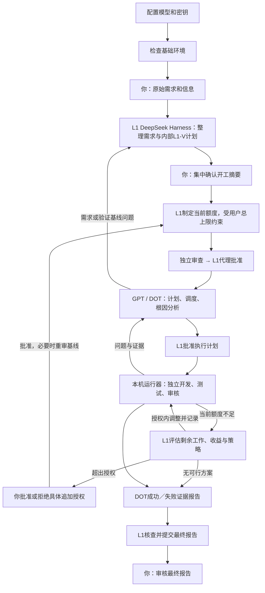

# ReqPilot · 需求领航


**从需求沟通到独立开发、测试与审核，由 L1 引导、GPT/DOT 统筹，最终提交有证据的报告。**

原项目名 AI-Programming-Workflow。[名称、图标与升级兼容说明](docs/guides/branding.md)。

**你向L1提供原始需求、参数和环境，并在开工前集中确认一次边界。L1生成、独立审查并批准需求与执行计划，通过GPT API调用DOT组织开发、测试、审核，最后由L1提交成功或失败报告给你审核。** 当前版本 **3.5.0**。

默认顺序：**配置模型和密钥 → 检查环境 → 沟通原始需求 → 集中确认开工 → L1 自动推进 → 用户审核最终报告**。



## 从这里开始

| 文件 | 用途 |
| --- | --- |
| [AGENTS.md](AGENTS.md) | Agent共同规则与审批边界 |
| [L1.md](L1.md) | 唯一用户入口、代理审批和最终报告 |
| [DOT.md](DOT.md) | GPT/DOT调度、独立执行与回流 |
| [L1插件使用指南](docs/guides/l1-plugin.md) | 安装、配置向导、环境检查与一次开工确认 |
| [MCP工具桥指南](docs/guides/l1-harness.md) | 手动集成与终端审核后备方式 |
| [首次跑通](docs/guides/first-run.md) | 从小任务验证完整流程 |
| [模板](templates/README.md) | 由L1/DOT维护的需求、计划、委托和报告 |

中间审批由L1完成，范围内变更也回L1。你确认目标、权限、资源总上限和截止时间，L1自动制定并调整细粒度参数。达到当前额度先由L1评估；超出授权时向你申请具体变更，无可行方案才提交失败/未完成报告。最终报告列出调整理由、实际消耗及结果，不能清零历史或无限重试。用户无需另外操作DOT或维护内部清单。

## 已实现与接入限制

仓库实现了本地MCP stdio工具桥、OpenAI Responses API计划/调度/根因分析适配、独立Codex会话、L1代理审批、候选与证据校验、累计预算和最终人工报告门禁。GPT模型需在本机显式配置，API密钥仅从桥进程环境读取，不写入仓库或发给工作会话。

3.2.0增加同一任务内的NEEDS_INFO澄清、追加事实和重新规划；原授权、确认及累计消耗不变，新基线须独立审查。提供可安装的DeepSeek Harness原生插件包，添加“ReqPilot · 需求领航”专用入口。插件引导用户在本机配置页输入密钥，通过宿主凭据服务保存；用户主动完成两项API兼容性探测后，L1先独立检查基础环境，通过后才进行九项需求沟通；需求明确后复核项目特有环境，再用原生提问集中确认开工。后续中间审批仍由L1完成，最终报告也可在同一会话由用户审核。旧MCP工具桥继续作为手动接入方式。

3.2.2将完整计划的纯校验拒绝改为可修正的PLAN_REJECTED，保留诊断、API和时间消耗。实现预算明确为全任务初次与修复的累计L3派工数；构建、Doxygen、HIL与独立审核保留在验证部分。真实中断及旧版锁定任务不会自动解锁，详见[计划拒绝指南](docs/guides/plan-rejections.md)。

插件源码接口已按本机DeepSeek Harness 0.2.2-rc.3核对，并有配置页、管道和拒绝测试；尚未宣称已安装进你的真实Harness会话，也未用真实API密钥完成完整产品任务。自检和模拟通过不等于产品/HIL验收通过。详见[3.5.0验证记录](docs/reports/3.5.0-validation.md)。

本机审批记录不是受信签名服务；测试命令执行器不是OS沙箱，独立会话也不等于同账户安全隔离。现有分支/设备/部署保护照常保留。没有外部交付执行器，不自动合并、发布或刷写。

## 保留的规范与技术内容

双L1职责（Product L1与内部L1-V）、L2～L5、21章技术参考、16类L4/12类L5回流、48项正式系统拒绝场景均保留；默认中间批准主体改为L1，最终报告仍由用户审核。

嵌入式C使用 [华为项目规范V1.3](standards/embedded-c/README.md)：145父项、50子项、33条汇总规则及18章原技术内容。注释按 [Doxygen采用清单](standards/embedded-c/v1.3/doxygen/README.md) 的12项/33子项执行；冲突以华为为准。真实Doxygen检查入口保留，工具通过不代替语义审查或产品验收。

```powershell
python scripts/validate_repo.py
python -m unittest discover -s tests -v
```

以上验证仓库及运行器，不证明产品/HIL合规。版本历史见 [CHANGELOG](CHANGELOG.md)，按需导航见 [START_HERE](START_HERE.md)。

编程规范新增[通用编程与交付约束](standards/embedded-c/v1.3/project-constraints/README.md)：完整追踪用户材料U01～U26，并将适用范围推广至新项目的自有C/H。华为优先，Doxygen保留；规范摘要及独立审查接入运行器，源码语义仍需实际验证。

本次约束整合的检查范围见[3.0.1验证记录](docs/reports/3.0.1-validation.md)。

L1与DOT默认采用[合作沟通约束](docs/guides/l1-dot-communication.md)：信息足够、事实有据、聚焦任务、表达清楚。已接入现有API和L1工具桥提示，不增加工具或审批回合；尚未量化效率收益。

L1面向你的需求沟通与最终报告已加入[选择性表达规则](docs/guides/l1-user-expression.md)：结论优先、减少套话、保留异议和事实、分层呈现。有条件借鉴anti-defensive-writing并固定来源与MIT许可，排除更换评价口径、隐藏失败等不适用规则；不增加插件、模型调用或人工审批。接入和检查范围见[3.0.3验证记录](docs/reports/3.0.3-validation.md)，实际沟通效果尚未量化。

3.3.0新增[动态资源管理与追加授权](docs/guides/adaptive-resources.md)：新任务由用户确认总边界，L1分配当前额度；额度耗尽先评估，原生用户决定是否扩大授权。完整调整历史进入最终报告。旧任务不自动迁移，UNKNOWN与最终报告不自动解锁；本版仍没有统一货币硬上限。

3.4.1增加[自动更新](docs/guides/automatic-updates.md)：安装一次带更新器的版本后，默认在工作流活动时每6小时检查正式发布；私有仓库复用本机GitHub登录，凭据不进入模型或日志。未开工会话可无重启采用兼容新版；已确认任务默认保留原运行版本和完整记录；3.5.0可另行原生确认迁移。新工具或宿主接口变化仍需升级安装包。安装包见[正式发布下载](https://github.com/Merrychen-CMY/ReqPilot/releases/latest)。

3.5.0新增[已开工任务原对话升级](docs/guides/task-upgrades.md)：一次升级入口安装后，兼容任务可预检、原生确认并在同一对话继续；累计消耗和证据保留，重新独立审核与验证。UNKNOWN、终态和运行中操作不通过升级解锁。
