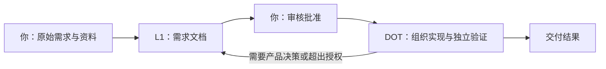

# AI 自动编程流程：L1 → 审核 → DOT

**你描述需求，L1整理成文档；你审核批准后，由DOT组织开发、验证和交付。** 默认版本 **2.3.0**。



## 从这里开始

| 文件 | 用途 |
| --- | --- |
| [AGENTS.md](AGENTS.md) | Agent最短入口和共同规则 |
| [L1.md](L1.md) | 需求沟通、生成文档、审核与交接 |
| [DOT.md](DOT.md) | 开发调度、验证、失败修复与交付 |
| [templates/requirements.md](templates/requirements.md) | 用户只需审核的统一需求文档 |

先把仓库固定提交的入口交给负责L1的Agent，再用自然语言说明需求即可。启动文字见 [agent-start.md](templates/agent-start.md)。获批准后，L1交给已连接且获授权的DOT执行；未接通时输出同一份交接资料和连接缺口，不冒称已运行。

## DOT自行处理什么

任务拆分、方案协调、开发、普通修复、测试计划维护、环境恢复和证据整理，都在已批准范围与预算内推进。需求/AC变化、扩大权限或预算、无法解决的阻断，以及未获授权的交付，才集中交给用户决定。

保留三个检查点：**开工前确认需求与范围；完成前独立验证；交付时核对授权**。三个检查点不等于三次人工审批。

## 内部规则按需查

原双L1和L2～L5作为内部职责保留：DOT承担L2编排与L5汇总，验证计划职责保留L1-V含义，开发与独立验证保留职责隔离。不要求六个独立对话，也不把全部资料一次装进上下文。

- [阅读导航](START_HERE.md) / [机器索引](INDEX.json)
- [简化流程策略](policy/simple-flow.json) / [核心规则](docs/core-rules.md)
- [首次跑通](docs/guides/first-run.md) / [进阶技术参考的适用范围](docs/advanced-profile.md)
- `docs/reference/`保留21章原技术内容；`policy/`保留16类L4、12类L5回流场景和48项真实系统拒绝测试清单。

这是流程规范与模板仓库，不包含已经接通的DOT、执行控制器或部署服务。根据项目能力选择接入；已有安全保护和正式门禁照常生效。

## 已整合的编码规范

嵌入式C项目采用 [华为参考的项目规范V1.3](standards/embedded-c/README.md)：33条规则（含8条可读性规则），按L1、DOT、开发和独立验证职责落实。规范正文拆成18个可按需读取的章节/附录，并保留5份Schema、4份DRAFT模板及原只读校验工具。你仍只审核一份需求文档，内部记录由DOT组织维护。

本次整合未部署产品源码格式/静态检查器、产品测试执行器、烧录或夹具。原契约工具只检查结构及部分状态；跨文件与真实执行核验仍由实际项目补齐。

## 仓库检查

Python 3.10+，仅标准库：

```powershell
python scripts/validate_repo.py
python -m unittest discover -s tests -v
```

检查链接、结构化规则、内容清单及关键反例，不执行产品/HIL验收。48项真实系统测试仍为NOT_RUN。维护见 [CONTRIBUTING.md](CONTRIBUTING.md)，变化见 [CHANGELOG.md](CHANGELOG.md)。
