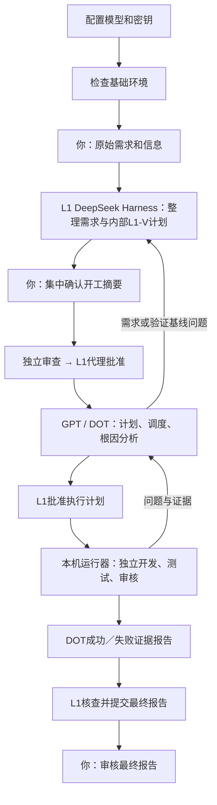

# AI自动编程流程：只沟通需求，只审核最终报告

**你向L1提供原始需求、参数和环境，并在开工前集中确认一次边界。L1生成、独立审查并批准需求与执行计划，通过GPT API调用DOT组织开发、测试、审核，最后由L1提交成功或失败报告给你审核。** 当前版本 **3.1.1**。

默认顺序：**配置模型和密钥 → 检查环境 → 沟通原始需求 → 集中确认开工 → L1 自动推进 → 用户审核最终报告**。



## 从这里开始

| 文件 | 用途 |
| --- | --- |
| [AGENTS.md](AGENTS.md) | Agent共同规则与审批边界 |
| [L1.md](L1.md) | 唯一用户入口、代理审批和最终报告 |
| [DOT.md](DOT.md) | GPT/DOT调度、独立执行与回流 |
| [L1插件使用指南](docs/guides/l1-plugin.md) | 安装、配置向导、环境检查与一次开工确认 |
| [MCP工具桥指南](docs/guides/l1-harness.md) | 手动集成与终端审核后备方式 |
| [首次跑通](docs/guides/first-run.md) | 从小任务验证完整流程 |
| [模板](templates/README.md) | 由L1/DOT维护的需求、计划、委托和报告 |

中间审批由L1完成，范围内变更也回L1。超出原始目标、预算或权限，或者关键事实无法确定时，形成受阻报告；不能修改用户参数、降低验收标准或无限重试。用户无需另外操作DOT或维护内部清单。

## 已实现与接入限制

仓库实现了本地MCP stdio工具桥、OpenAI Responses API计划/调度/根因分析适配、独立Codex会话、L1代理审批、候选与证据校验、累计预算和最终人工报告门禁。GPT模型需在本机显式配置，API密钥仅从桥进程环境读取，不写入仓库或发给工作会话。

3.1.1提供可安装的DeepSeek Harness原生插件包，添加“AI 编程 L1”专用入口。插件引导用户在本机配置页输入密钥，通过宿主凭据服务保存；用户主动完成两项API兼容性探测后，L1先独立检查基础环境，通过后才进行九项需求沟通；需求明确后复核项目特有环境，再用原生提问集中确认开工。后续中间审批仍由L1完成，最终报告也可在同一会话由用户审核。旧MCP工具桥继续作为手动接入方式。

插件源码接口已按本机DeepSeek Harness 0.2.2-rc.3核对，并有配置页、管道和拒绝测试；尚未宣称已安装进你的真实Harness会话，也未用真实API密钥完成完整产品任务。自检和模拟通过不等于产品/HIL验收通过。详见[3.1.1验证记录](docs/reports/3.1.1-validation.md)。

本机审批记录不是受信签名服务；测试命令执行器不是OS沙箱，独立会话也不等于同账户安全隔离。现有分支/设备/部署保护照常保留。没有外部交付执行器，不自动合并、发布或刷写。

## 保留的规范与技术内容

双L1职责（Product L1与内部L1-V）、L2～L5、21章技术参考、16类L4/12类L5回流、48项正式系统拒绝场景均保留；默认中间批准主体改为L1，最终报告仍由用户审核。

嵌入式C使用 [华为项目规范V1.3](standards/embedded-c/README.md)：145父项、50子项、33条汇总规则及18章原技术内容。注释按 [Doxygen采用清单](standards/embedded-c/v1.3/doxygen/README.md) 的12项/33子项执行；冲突以华为为准。真实Doxygen检查入口保留，工具通过不代替语义审查或产品验收。

```powershell
python scripts/validate_repo.py
python -m unittest discover -s tests -v
```

以上验证仓库及运行器，不证明产品/HIL合规。版本历史见 [CHANGELOG](CHANGELOG.md)，按需导航见 [START_HERE](START_HERE.md)。

编程规范新增[通用编程与交付约束](standards/embedded-c/v1.3/project-constraints/README.md)：完整追踪用户材料U01～U26，并将适用范围推广至新项目的自有C/H。华为优先，Doxygen保留；规范摘要及独立审查接入运行器，源码语义仍需实际验证。

本次约束整合的检查范围见[3.0.1验证记录](docs/reports/3.0.1-validation.md)。

L1与DOT默认采用[合作沟通约束](docs/guides/l1-dot-communication.md)：信息足够、事实有据、聚焦任务、表达清楚。已接入现有API和L1工具桥提示，不增加工具或审批回合；尚未量化效率收益。

L1面向你的需求沟通与最终报告已加入[选择性表达规则](docs/guides/l1-user-expression.md)：结论优先、减少套话、保留异议和事实、分层呈现。有条件借鉴anti-defensive-writing并固定来源与MIT许可，排除更换评价口径、隐藏失败等不适用规则；不增加插件、模型调用或人工审批。接入和检查范围见[3.0.3验证记录](docs/reports/3.0.3-validation.md)，实际沟通效果尚未量化。
