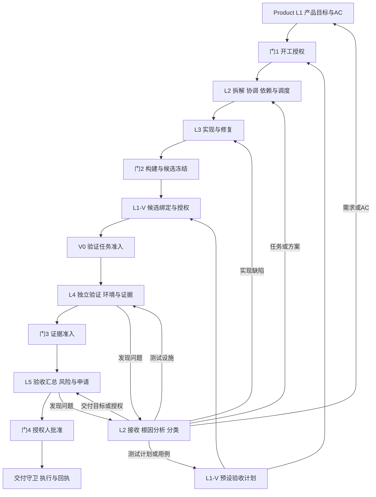

# 架构与基线

图中回流箭头均表示L2已完成分诊后的调度。计划/需求修改后须先更新基线和适用授权，不能从图上的箭头推断可跳过G2、V0或重验。纯交付事项按 [重验规则](../policy/reverification.json) 判断是否需要产品重验。

控制器负责持久化状态、幂等、计数、身份/批准校验；L2负责根因与调度决定。控制器不是额外一个需求决策层。角色可以使用同一工作台展示，但实现者、验证者、审批人与交付权限的实际隔离仍需落实。
