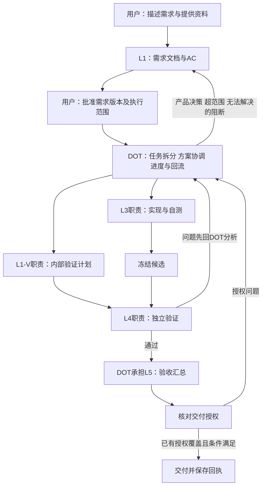

# 默认架构：用户只面对L1与DOT

用户只需审核一份需求文档。内部验证计划由指定验证职责维护。DOT的调度和汇总可以共用工作台，开发与独立验证的执行权限不能因此混同。

三个检查点是开工授权、独立验证、交付授权核对。正式G1/G2/V0/G3/G4是这些边界的内部实现；接入方式见 [进阶说明](advanced-profile.md)。按已有明确授权自动核验不等于取消门禁，也不等于每个检查点都让用户再次点击批准。
