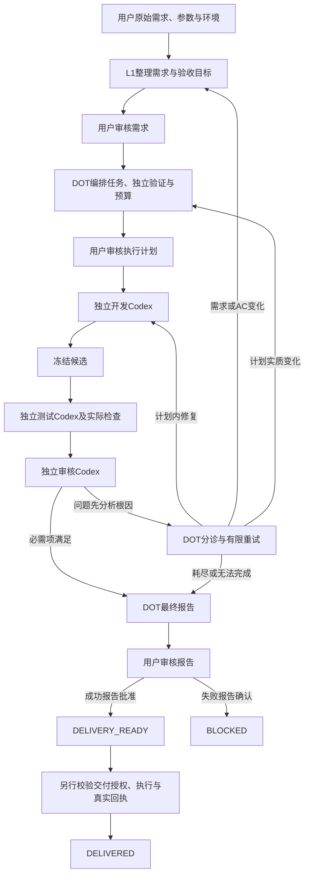

# 默认架构：三次审核，DOT组织独立执行

需求审核只允许DOT准备计划，计划审核后才能实现。用户不维护内部任务JSON或华为适用性清单。DOT负责L2调度及L5汇总，内部L1-V形成验证计划；开发、测试和审核由三个独立执行会话承担。

成功报告审核、独立测试和交付授权各有作用，不能互相替代。失败报告确认不授权再次尝试。已启用的正式G1/G2/V0/G3/G4和安全隔离继续适用；详细技术阶段必须满足当前三审核规则，见 [适用范围](advanced-profile.md)。本地运行器止于DELIVERY_READY或BLOCKED，不执行图中外部交付部分。
