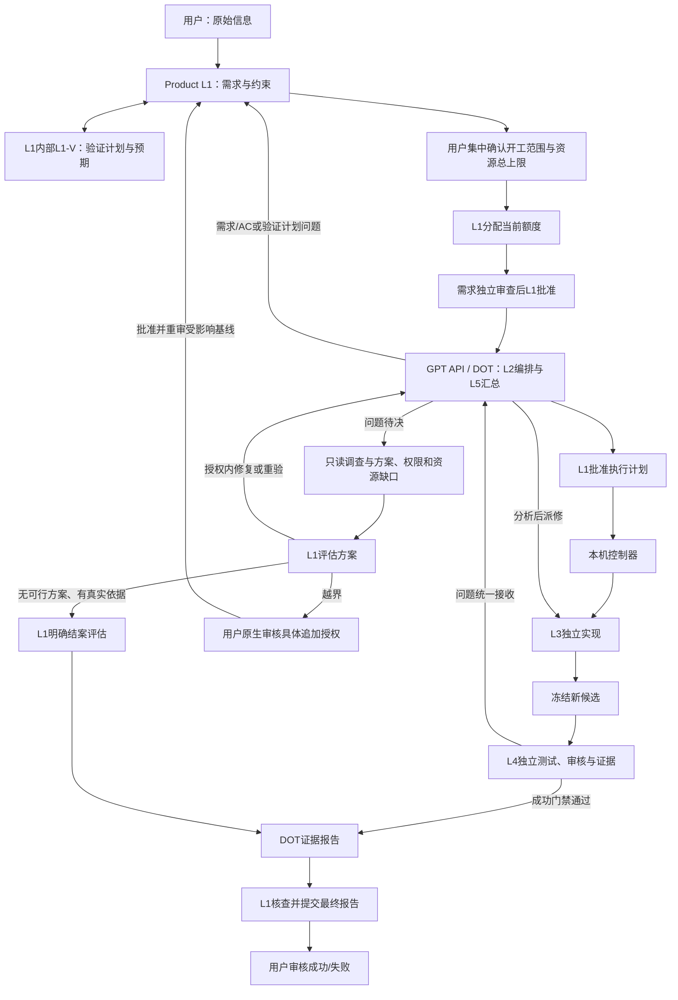

# 默认架构：用户确认边界，L1代理审批，最终报告交用户审核

需求和计划是内部批准对象，用户不用操作DOT。L1代理批准与用户最终批准是不同身份、不同记录。独立审查可否决L1草案；不以一次模型自述代替审查。

GPT API承担规划、受控调度和根因分析；代码/工具仍由本机执行器处理。内部L1-V不合并到产品实现者。L4/L5不能绕过L2直接回L3；详细路由见 [L4矩阵](../policy/l4-failures.json)、[L5矩阵](../policy/l5-delivery.json)。

修订在当前用户授权内进行；越界方案先交L1申请具体追加授权，缺事实继续有边界的调查，不直接结案。非成功报告必须经过L1明确评估，依据限于无可行方案、用户原生确认停止或实际触达且不可调整的全任务上限。保留不受影响的已完成实现；候选变化重验、旧PASS不能复用、累计预算不可重置。没有发布执行器，成功报告经用户审核也只到DELIVERY_READY。新原生任务强制先审需求再规划与动态额度；完整工具顺序见[流程与恢复](guides/flow-recovery.md)。
