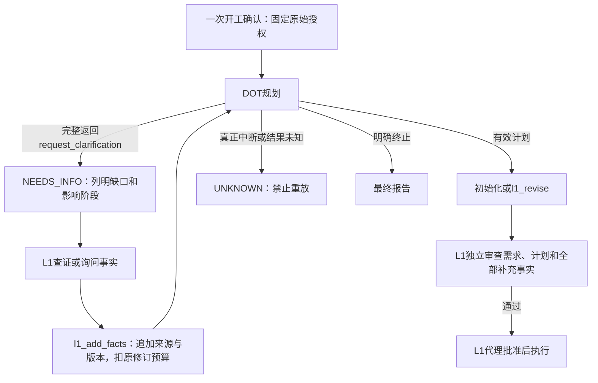

# 同一任务内补充事实与重新规划

适用于3.2.0及以后创建的任务。禁止清零消耗、静默扩大授权或改写历史；允许在原授权及剩余预算内追加事实，由L1组织独立审核并批准新基线。此能力不更换当前GPT API版DOT。

## 按实际结果分别处理

| 情况 | 处理 | 可否继续原任务 |
| --- | --- | --- |
| DOT完整返回缺失资料清单 | NEEDS_INFO，L1核实并补充 | 可以；保留全部次数、时间和原确认 |
| 完整草案的纯格式/计划校验拒绝（3.2.2起） | PLAN_REJECTED，L1/DOT读取诊断并修正 | 可以；只在原授权与剩余预算内重审，不改AC或扩大权限 |
| 传输中断、进程或执行结果未知 | UNKNOWN，核实旧操作，不自动重放 | 本接口不能解除UNKNOWN |
| 当前额度耗尽、授权需要调整（动态任务） | 按动态资源规则进入L1评估或原生用户授权 | 不能靠事实文本扩权；独立资源入口可受控调整 |
| 明确终止、UNKNOWN或最终失败报告 | 保持终态与核实规则 | 不能靠补事实重新打开 |

NEEDS_INFO是规划子状态：初始化前由status直接返回；初始化后附在PLAN_PENDING/DECISION_PENDING上，不改写控制器的执行状态。信息请求不是产品执行失败，也不等于批准新计划。

草案误写了超范围路径或预算，可先拒绝再修回原边界；这不授予扩大授权的权限。PLAN_REJECTED恢复和实现预算单位见[计划拒绝指南](plan-rejections.md)。

## L1的实际操作

1. `dot_plan`返回NEEDS_INFO时，读取`planning.reason`、`planning.gaps`，保持原任务和目录；相同输入再次规划不会发送API请求。
2. 查已有资料和工具证据；确需用户提供的事实可以询问，不把资料澄清变成新的开工审批。用户已提供的事实无需重复问。
3. 按[事实补充模板](../../templates/fact-supplement.example.json)准备`facts_json`，调用`l1_add_facts`。每项包含名称、实际值、具体来源和影响阶段。支持planning、build、test、documentation、delivery。模板由L1填写，用户无需操作JSON。
4. 检查`accepted`；拒绝时修正输入或说明边界，不谎称已经记录。原始信息、delegation、开工回执及bridge设置不修改；新记录位于控制目录facts/，以摘要链和索引保留每一版。
5. 调用`dot_plan`，传入完整更新后的需求。DOT同时收到原环境和全部事实补充，补充内容不得扩大授权或改换明确用户参数。
6. 未初始化任务：`dot_initialize` → `l1_approve(requirements)` → `l1_approve(plan)`。已初始化且在PLAN_PENDING/DECISION_PENDING暂停：`l1_revise` → 两项独立审查和代理批准。其他执行中/终态不接受事实更新。
7. 独立审查读取原始输入、委托、需求、计划、fact-supplements.json，拒绝冲突、缺乏来源、弱化AC或扩权。补充事实本身不是批准，USER_ATTESTED也不是工具实测。事实摘要进入批准/候选绑定和最终报告。

## 预算与重新验证

- 一批有效事实补充消耗一次原有`revisions`预算；初始化后随后的`l1_revise`使用这次已计数的修订，不重复扣同一事务。再追加一批事实仍消耗一次。
- API请求按原ledger累计，包括返回缺口的请求；等待澄清不重置总墙钟时间、到期时间、已用审查/实现次数或根因失败记录。
- 新事实使旧草案不能初始化；已初始化任务必须修订并清除旧批准。现有修订逻辑使候选及完成标记失效，重新按新基线验证，不复用旧PASS。
- 范围、硬约束、可写路径、预算、有效期和交付授权均不接受本工具直接修改。自然语言是否改变目标仍须独立审查，本机记录不是强鉴权边界。

## UNKNOWN按依赖阶段判断

ESP-IDF版本若决定接口和构建方案，应在规划前核实；串口若仅用于后续板上测试，可以先分析不依赖设备的内容。Doxygen存在性不代表文档构建通过；构建目录须在既有路径授权内。

开工检查拒绝必需手工证据中的UNKNOWN、TBD、未知、待确认等占位内容；不声称能自动理解全部自然语言。L1仍须识别遗漏的必需检查。晚阶段缺口只能在计划已安排可执行前置检查、能阻止依赖动作时延期；当前计划结构无法表达或落实该条件时，必须先澄清，不能添加一个无人执行的门禁字段或伪造通过。

## 已被旧版锁定的任务

本版不自动重写3.1.x确认摘要、版本指纹、最终失败报告或interrupted.json。旧版把缺资料写成最终失败/UNKNOWN后，不能仅凭错误文字断定可以恢复。先保存并检查原API响应、预算、项目快照、用户报告审核和进程状态，再单独确定迁移；未提供通用旧任务迁移工具。不能删除记录、清空预算或换会话冒充从未失败。

## 拒绝与回归验证

自动化覆盖同任务缺口→补充→规划→独立审查、原确认与累计时间不变、相同缺口不盲重试、过期/修订预算、篡改历史、伪造身份、旧计划失效、未结束进程、终态拒绝及UNKNOWN不重放。模型使用模拟响应，真实API及产品/HIL结果仍须另行验证。

3.3.0将资源变更与事实补充分开：[动态资源管理](adaptive-resources.md)允许L1在用户上限内调整，并通过独立原生界面申请扩大总上限或延期。clarification_policy中的expiry_extension_allowed:false专指事实补充工具无权改期限，不禁止经过用户批准的独立授权版本。累计时间和事实历史都不重置。
