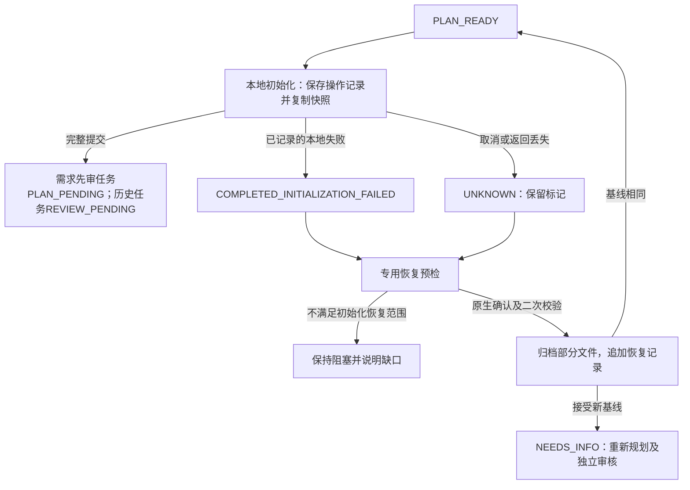

# 初始化中断的受控恢复

本入口恢复“规划已完成，但本地初始化尚未完整提交”的任务。3.13.0同时支持当前版本的部分快照失败，以及旧版已写state.json、却尚未完成委托绑定或需求审核承接的半初始化。它只整理本地控制记录，不调用GPT、不启动Codex、不修改产品文件。不能用它处理产品执行结果未知、未完成API请求、完整初始化后的任务或最终报告。

## Windows长路径修复

控制目录较深时，嵌入式构建产物的备份路径可能超过传统260字符限制。3.6.0在快照扫描、复制、校验和恢复归档读取中使用Win32扩展长度路径，不修改系统注册表，也不通过删除build目录规避问题；构建输入仍纳入一致性校验。路径用于文件I/O，记录中的项目身份和相对文件名保持原格式；链接/重解析点、越界、已有副本覆盖和并发变更仍被拒绝。此修复不保证第三方编译器或所有外部工具都支持长路径。依据[Microsoft Windows路径说明](https://learn.microsoft.com/en-us/windows/win32/fileio/maximum-file-path-limitation)。

## 用户使用

先在Harness安装当前插件包，确保初始化恢复入口已经加载；实际使用的版本以工具返回为准。旧入口不能仅通过下载运行器获得自身没有的操作，不承诺宿主热替换。

在原L1会话说：“检查初始化中断，提供恢复预览”。L1调用`workflow_updates(action=initialization_preview)`，展示失败信息、原/当前项目指纹与文件数量、已有API用量、归档范围和目标运行版本。

然后调用`workflow_updates(action=initialization_recover)`显示原生审核界面。用户明确批准后，控制器再次核对完全相同的项目和记录，归档部分快照及旧中断标记，追加恢复历史，在原会话切换到包含修复的运行器。模型不能提供“已批准”字段。

基线和运行版本未变化时保留有效规划及已有需求独立批准；之后`dot_initialize`完整承接原需求审核，不重复消费需求审核额度，随后独立审核并批准计划。基线变化时，界面明确要求批准所示新基线；原确认不改写，以追加记录表达新起点，原规划转为NEEDS_INFO。新任务先整理并独立审核更新后的需求，再重新规划、初始化和独立审核计划。恢复同时迁移运行版本时，原需求审核记录仍完整保留，但须根据新运行基线重新审查，不能复制旧PASS。新审核、规划仍计入累计预算；恢复本身不会重发原规划请求。用户不接受当前基线时保持原状，先核实变化，不能猜测删除的都是缓存。没有需求先审收据的历史任务沿用其原始顺序，不能伪造历史批准。

旧版开工记录只有项目摘要与文件数量，可能无法还原完整逐文件差异；部分初始化副本不能冒充完整备份。没有证据不能宣称“原始失败原因已查明”或“所有副作用已排除”。

## 允许与拒绝

| 条件 | 处理 |
|---|---|
| 白名单内的原生任务，包括3.12.1和3.13.0，dot_initialize中断、无state.json、API账本已核实 | 可提交准确恢复预览；完整兼容名单见policy/initialization-recovery.json |
| 新版已记录FAILED的本地初始化失败，没有外层UNKNOWN | 同样要求原生恢复确认 |
| 初始化原子写入在替换前失败，遗留state.json或initialization.json的规范UUID临时文件 | 作为未提交材料逐字节归档，不采用临时内容作为有效状态；其他未知文件仍拒绝 |
| 旧版state.json已存在，但未完成委托绑定或原需求审核承接；无派工、候选、执行会话或计划批准 | 严格核验状态、原始输入和快照后，归档半初始化及已复制审核材料，保留原需求审核源记录和全部账本，再进行本地初始化 |
| 项目与原基线不同 | 展示准确新指纹，批准采用后必须重新规划、独立审核 |
| 锁被占用、记录在确认期间变化、原授权被篡改 | 拒绝恢复 |
| 未完成API请求、dot_run/dot_plan等其他UNKNOWN | 拒绝；不得通用解锁 |
| 完整state.json已提交、产品派工/验证证据、最终报告或未知运行文件 | 拒绝；完整提交后仅丢失返回的情况走普通操作核实，不能当作半初始化重建 |
| 已批准恢复过程自身中断 | 用initialization_finish完成相同本地写入，不重新请求批准或重放产品动作 |

恢复保留原始输入、confirmation、delegation、权限、总上限、截止时间、API账本、资源账本及累计次数。原授权已经到期或当前额度耗尽时，恢复不会顺便延长或增加；后续仍走现有L1评估/原生追加授权流程。

## 状态与持久化

新初始化记录`control/run/initialization.json`，包含操作ID、阶段、时间及真实本地错误。原生任务必须先完成快照、委托校验与绑定、已有需求审核证据承接，最后一次性写入完整state.json。提交前任一步失败都保留部分文件且不产生可执行状态；已确认的本地失败返回结构化拒绝，外层清理本轮在途标记。返回丢失/进程取消仍保留UNKNOWN。完整状态提交后再中断，不回滚审批、计数或状态，必须走普通操作核实。

恢复使用任务、控制、运行目录的跨进程锁。准备阶段生成准确快照摘要；批准后复核并保存`initialization-recovery-pending.json`，随后将部分文件和中断标记归档至`initialization-archives/<摘要>/`，追加`initialization-recoveries.json`。旧版半初始化还归档原state.json及run目录内已复制的需求审核材料；control目录中的原需求审核、API和资源账本保持原样。版本变化同时追加原有运行版本链。原文件不静默删除，已用消耗不重置。

恢复中断后普通操作及版本升级暂停；`initialization_finish`只接受预先记录的精确前/后状态。产品或记录出现额外变化、路径重定向或损坏时拒绝覆盖。日志是同账户本地审计记录，不是签名授权服务。

## 验证与报告

测试覆盖：当前与已列明源版本恢复、绑定失败、审核材料复制中断、原子替换前失败及临时文件归档、旧版绑定前/承接前半初始化、完整状态提交后丢失返回、恢复再中断、准确用量和原审批记录保留、原生拒绝/跳过/伪造回执、基线变化及重新规划、确认期间变化、未完成API、活动锁、已派工/完整初始化/终态拒绝及损坏记录拒绝。模拟工作者不作为产品/HIL验收。

状态及最终报告包含初始化恢复历史。执行成功仍必须满足原独立验证、候选及真实证据要求；恢复成功只表示控制记录整理完成。
