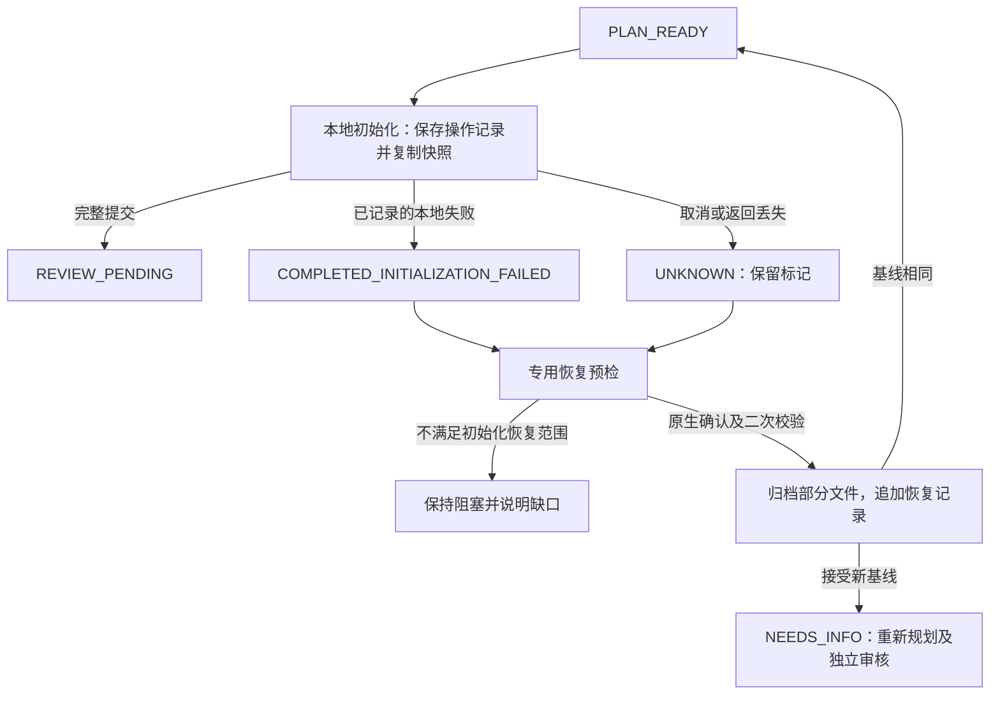

# 初始化中断的受控恢复

3.6.0补齐“规划已完成，但首次初始化没有提交运行状态”的恢复入口。它只整理本地控制记录，不调用GPT、不启动Codex、不修改产品文件。不能用它处理产品执行结果未知、未完成API请求、已初始化任务或最终报告。

## Windows长路径修复

控制目录较深时，嵌入式构建产物的备份路径可能超过传统260字符限制。3.6.0在快照扫描、复制、校验和恢复归档读取中使用Win32扩展长度路径，不修改系统注册表，也不通过删除build目录规避问题；构建输入仍纳入一致性校验。路径用于文件I/O，记录中的项目身份和相对文件名保持原格式；链接/重解析点、越界、已有副本覆盖和并发变更仍被拒绝。此修复不保证第三方编译器或所有外部工具都支持长路径。依据[Microsoft Windows路径说明](https://learn.microsoft.com/en-us/windows/win32/fileio/maximum-file-path-limitation)。

## 用户使用

先在Harness更新安装3.6.0插件包，确保新入口已经加载。此版为bootstrap ABI4；旧ABI3不能仅通过下载运行器获得新恢复操作，旧会话是否加载新入口以实际工具返回为准，不承诺宿主热替换。

在原L1会话说：“检查初始化中断，提供恢复预览”。L1调用`workflow_updates(action=initialization_preview)`，展示失败信息、原/当前项目指纹与文件数量、已有API用量、归档范围和目标运行版本。

然后调用`workflow_updates(action=initialization_recover)`显示原生审核界面。用户明确批准后，控制器再次核对完全相同的项目和记录，归档部分快照及旧中断标记，追加恢复历史，在原会话切换到包含修复的运行器。模型不能提供“已批准”字段。

基线未变化时保留有效规划；之后`dot_initialize`，再做需求和计划的独立审查及L1代理批准。基线变化时，界面明确要求批准所示新基线；原确认不改写，以追加记录表达新起点，原规划转为NEEDS_INFO，由L1检查需求、重新规划，再初始化和独立审核。新规划会消耗原API预算；恢复本身不会重发原规划请求。用户不接受当前基线时保持原状，先核实变化，不能猜测删除的都是缓存。

旧版开工记录只有项目摘要与文件数量，可能无法还原完整逐文件差异；部分初始化副本不能冒充完整备份。没有证据不能宣称“原始失败原因已查明”或“所有副作用已排除”。

## 允许与拒绝

| 条件 | 处理 |
|---|---|
| 3.5.0/3.6.0原生任务，dot_initialize中断、无state.json、API账本完整完成 | 可提交准确恢复预览 |
| 新版已记录FAILED的本地初始化失败，没有外层UNKNOWN | 同样要求原生恢复确认 |
| 项目与原基线不同 | 展示准确新指纹，批准采用后必须重新规划、独立审核 |
| 锁被占用、记录在确认期间变化、原授权被篡改 | 拒绝恢复 |
| 未完成API请求、dot_run/dot_plan等其他UNKNOWN | 拒绝；不得通用解锁 |
| state.json已存在、派工/审核证据、最终报告或未知运行文件 | 拒绝；另行核实，不清零、不撤销报告 |
| 已批准恢复过程自身中断 | 用initialization_finish完成相同本地写入，不重新请求批准或重放产品动作 |

恢复保留原始输入、confirmation、delegation、权限、总上限、截止时间、API账本、资源账本及累计次数。原授权已经到期或当前额度耗尽时，恢复不会顺便延长或增加；后续仍走现有L1评估/原生追加授权流程。

## 状态与持久化

新初始化记录`control/run/initialization.json`，包含操作ID、阶段、时间及真实本地错误。只有快照完成才写state.json。快照异常保留部分文件；已确认的本地失败返回结构化拒绝，外层清理本轮在途标记，不再误称传输结果未知。返回丢失/进程取消仍保留UNKNOWN。

恢复使用任务、控制、运行目录的跨进程锁。准备阶段生成准确快照摘要；批准后复核并保存`initialization-recovery-pending.json`，随后将部分文件和中断标记归档至`initialization-archives/<摘要>/`，追加`initialization-recoveries.json`。版本变化同时追加原有运行版本链。原文件不静默删除，已用消耗不重置。

恢复中断后普通操作及版本升级暂停；`initialization_finish`只接受预先记录的精确前/后状态。产品或记录出现额外变化、路径重定向或损坏时拒绝覆盖。日志是同账户本地审计记录，不是签名授权服务。

## 验证与报告

测试覆盖：部分初始化恢复、准确用量保留、原始文件不变、原生拒绝/跳过/伪造回执、基线变化及重新规划、确认期间变化、未完成API、活动锁、初始化已提交及终态拒绝、恢复再中断和损坏记录拒绝。模拟工作者不作为产品/HIL验收。

状态及最终报告包含初始化恢复历史。执行成功仍必须满足原独立验证、候选及真实证据要求；恢复成功只表示控制记录整理完成。
