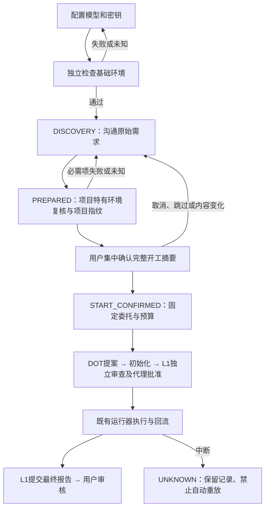

# ReqPilot · DeepSeek Harness 原生 L1 插件

本插件把配置、环境检查、需求引导、一次开工确认、DOT 工具和最终报告审核放到同一个 L1 会话。固定顺序为：**配置模型和密钥 → 检查环境 → 沟通原始需求 → 集中确认开工 → L1 自动推进 → 用户审核最终报告**。

## 安装和首次使用

1. 获取本仓库 3.2.1 安装包，或完整仓库目录。保留 `package.json`、`harness/` 以及运行器、策略、模板、规范目录，不要只复制一份提示词。
2. 在 DeepSeek Harness 的插件管理中添加本地插件包/目录。也可让 Harness 自身有插件管理能力的 Agent 使用 `plugin_manager install_bundle` 安装本地来源；实际参数以宿主工具声明为准。本仓库不直接修改你的 Harness 配置文件。
3. 创建新会话，选择 **ReqPilot · 需求领航**。安装包添加独立 preset，不替换默认 Agent，也不修改 dsh-spec-collab 的 Ready 规则。旧会话可能仍保留旧 preset，不能用来判断新插件是否生效。
4. 对 L1 说：**“开始一个项目，请按配置模型和密钥、检查环境、沟通需求的顺序引导我，再集中确认开工。”** L1 会提供本机配置页链接。在页面填写 GPT API 模型 ID、密钥及 Python/Codex 可执行文件路径。这里的 GPT 就是 DOT，不是另一个人工操作入口；L1 自己的模型仍由 Harness 设置。
5. 点击保存，再点击“测试 API”。测试发出两次可能计费的固定示例请求，核对工具调用和结构化输出兼容性，不发送项目内容。不在安装、打开页面或启动聊天时自动调用付费 API。
6. 回到 L1，先让它调用 `workflow_check_environment` 检查Python、Git、Codex及登录；此时无需提供项目目录或需求草案。失败/未知时先解决环境缺口，再继续。
7. 基础环境通过后，沟通原始需求并提供独立产品目录与已有资料。L1 根据九项话题补齐信息，再用 `workflow_inspect` 补查项目特有的编译器、测试入口、设备条件并固定基线。已有信息保留，不必重复提供。新项目目录至少有一份真实输入文件，例如原始需求；不要拿插件目录当产品目录。
8. 阅读原生提问中完整的开工摘要，确认模型、需求、基线、范围、AC、环境、测试、交付、安全、允许路径、预算和有效期，然后选择 **“确认开工并委托 L1 自动推进”**。不需要再手填需求/委托 JSON。
9. L1 调用 DOT，独立审核并批准需求和计划，自动运行。最后在同一会话展示 DOT 原始证据报告及 L1 结论，并让你选择 **“已审核此报告”**。失败/UNKNOWN 的确认不会授权重试；成功确认也不执行外部交付。

本版核对的宿主是本机 **DeepSeek Harness 0.2.2-rc.3**，构建提交 `6b729fedde0c8fd03af7afdf5a711aa64fe87c3b`。其他版本需要重新核对扩展接口。安装方式依据宿主随包的 dsh-agent-preset、plugin-manager、dsh-tools、dsh-user-questions、dsh-credentials 说明与源码；上游参考：[项目仓库](https://github.com/deepseek-ai/deepseek-harness)、[插件管理说明](https://github.com/deepseek-ai/deepseek-harness/blob/master/packages/boot/plugin-manager/README.md)。兼容性核对和本地自检不等于已在你的真实 L1 会话中安装或跑通产品任务。

## 环境检查的含义

第一步完成模型/密钥配置和API兼容性测试。第二步独立检查Python 3.11+、Git、Codex CLI及登录，无需原始需求，不发送API请求，也不将密钥传给检查进程。通过后才主动沟通原始需求。需求明确后，L1把具体编译器、依赖目录、测试入口和设备条件列入草案并补充复核；不能提前猜测项目环境。配置变更使旧基础检查失效，重查失败/中断不能保留旧PASS。路径存在只证明存在；设备等无法自动探测的条件使用 `USER_ATTESTED`，展示用户提供的证据。没有证据保持 UNKNOWN，必需项 FAIL/UNKNOWN 阻止开工。

实际构建、测试、Doxygen、独立审核与适用 HIL 仍在批准后的运行器中产生证据。插件不把环境检查当作产品验收，不自动安装软件、关闭安全机制或修改设备。

## 状态与恢复

### 配置或API测试失败

3.2.1配置页顶部显示版本号，失败提示包含固定错误编号、测试阶段及适用的HTTP状态。保存配置不调用API；测试API不运行Python/Codex，后者属于下一步基础环境检查。旧版统一提示不能用来判断密钥错误或额度不足。

| 错误编号 | 含义与处理 |
| --- | --- |
| CONFIG_INVALID / KEY_FORMAT | 检查字段和粘贴格式；不在聊天中提供密钥。 |
| CONFIG_READ / CONFIG_WRITE | 检查本地配置格式或目录权限。 |
| CREDENTIAL_READ / CREDENTIAL_WRITE | Harness凭据服务读写失败，检查宿主凭据功能。 |
| SETUP_REQUIRED | 先保存模型和密钥。 |
| API_AUTH（401） | 核对API密钥、项目/组织及IP访问权限，不能仅凭401确定密钥无效。 |
| API_ACCESS / API_REGION（403） | 核对账户/模型权限、官方支持地区和网络访问策略。 |
| API_MODEL（404） | 核对准确模型ID及当前项目访问权。 |
| API_QUOTA / API_RATE / API_LIMIT（429） | 分别表示已识别的额度限制、速率限制或无法区分；按实际类别检查。 |
| NETWORK_* | 连接、DNS、证书或超时问题；核对Harness进程网络，浏览器可访问不等于宿主可访问。不要关闭证书验证。 |
| API_OUTPUT_LIMIT / API_INCOMPLETE | 响应未完成，不能据此判定密钥无效；可能已计费。输出上限类需另行调整探测预算/推理设置，插件不会自行增加费用或重试。 |
| API_REQUEST / API_TOOL_FORMAT / API_JSON_FORMAT | 请求或输出不符合所选模型的兼容性要求。 |
| API_SERVER / API_HTTP / API_RESPONSE | 服务或响应异常，保留安全诊断用于排查。 |

错误分类依据[官方错误码](https://developers.openai.com/api/docs/guides/error-codes)与[推理输出限制](https://developers.openai.com/api/docs/guides/reasoning?api-mode=responses)。提示只包含本地固定文字、白名单分类及数字状态，不回显API错误正文、凭据服务异常、模型返回内容或请求头。每次点击最多两次请求、每次2048输出token和45秒超时；遇到失败立即停止，不自动重试、不切换模型、不扩大预算。

尚未开工的旧版用户可安装新版插件并重新加载宿主、新建AI编程L1会话和配置页。确认顶部版本后，保留已有配置，手动点击一次测试，把显示的错误编号与阶段交给维护者。正常升级保留宿主密钥和设置文件；不要删除配置或运行记录。已开工任务遵循下述固定版本与恢复规则。

配置、基础环境、需求沟通及准备/确认阶段属于开工引导，不替代既有 REVIEW_PENDING、PLAN_PENDING、EXECUTING、VERIFYING 等运行状态。每个 Harness 会话固定一个任务。记录在用户目录 `.ai-programming-workflow/tasks/<会话摘要>/`，与产品和插件代码分离；重启会话沿用记录，不能重置累计消耗。新目标应开启新会话、再次集中确认，并在基线字段关联旧报告，不能通过换会话绕过失败或预算。

工具在可能修改状态的操作之前记录 UNKNOWN 标记，收到完整结果才清除。宿主退出、取消、进程失败或结果不明会保留标记；只能查状态或提交停止/最终报告，不自动重放。终止桥进程不证明其所有后代进程已终止，需要核实旧进程和证据。DOT完整返回request_clarification会记录NEEDS_INFO并正常结束这次工具调用，清除本次在途标记；它允许同任务补事实并重新规划。真正中断、畸形响应或明确最终报告不因此解锁。详见[事实补充与恢复](clarifications.md)。

开工后不能静默切换模型、Python/Codex 路径、范围或预算。可以在原模型下更换凭据并重新测试 API。用户数据和项目文件变化须按基线规则处理。配置页是会话内临时本机服务，关闭或卸载插件使链接失效；不用于远程服务器上的浏览器配置。

最终报告超过原生界面 65,000 字符上限时，插件拒绝截断批准。L1 应提供完整报告文件，用户按[工具桥指南](l1-harness.md)使用原有终端报告审核；不得改用 L1 自动确认或隐去证据。

## 密钥、权限和已有规范

密钥由用户在本机密码输入框填写，经宿主 `credentials` 服务保存。普通设置文件只含模型/路径/探测状态和凭据指纹，不含密钥。页面仅监听 127.0.0.1，使用临时会话令牌、Host/Origin 检查，不回显密钥、不在错误中输出响应正文。凭据服务具体存储方式由宿主决定，本插件没有额外的操作系统密钥库保证。

执行时仅 GPT/DOT 桥子进程临时获得 `OPENAI_API_KEY`，不进入模型工具参数、命令行、仓库或 Codex/测试环境。当前仅支持官方 Responses 端点；没有自定义代理地址、自动选择模型、自动充值或自动创建密钥功能。OpenAI 的密钥保密要求见[官方 API 概览](https://developers.openai.com/api/reference/overview)。

开工摘要说明数据将发送到配置的模型服务，用户须确认实际需求中的敏感数据边界。原始输入、候选、证据仍可能包含业务信息，请保护本机记录。插件不是操作系统沙箱；同账户进程可访问的本地文件不能提供强隔离或签名审批保证。

华为编程规范、Doxygen、通用约束、格赖斯合作原则和 L1 表达规则仍通过原有入口/策略及运行器执行。L4/L5问题仍先回DOT/L2，按根因调度；插件不改变职责、不降低AC、不恢复逐份人工审批。

## 维护和验证

插件入口为 `harness/index.js`，打包根为仓库根。`harness/cordis.patch.yml` 声明专用 L1 preset。`workflow_reference` 提供受限只读规则读取；内部 Python 管道不直接暴露给模型。开工和最终确认来自 `ctx.userQuestions` 的原生人类答复，模型无法传入 `confirmed=true`。

运行 `node --test harness/tests/*.test.js`、`python -m unittest discover -s tests -v` 与 `python scripts/validate_repo.py`。打包用 `python scripts/package_harness.py --output <仓库外目录>/reqpilot-3.2.1.tgz`，只收录校验通过的MANIFEST文件，避免目录打包夹带Python缓存；无安装脚本，无额外第三方运行依赖，宿主提供 DSH 服务接口。禁止把本机密钥、配置、运行记录或缓存打包提交。验证边界见[3.2.1验证记录](../reports/3.2.1-validation.md)。

## 开工后发现资料缺口

读取[同任务事实补充与恢复](clarifications.md)。3.2.0的dot_plan可返回NEEDS_INFO；L1追加事实后继续原任务，无需重复开工确认。资料、审查、API及时间预算均保留，候选和旧批准按修订失效。3.1.x已锁定任务没有自动迁移，不删除旧记录或中断标记。

## 名称与图标

3.2.1起显示为 ReqPilot · 需求领航，使用透明罗盘图标。内部包名和数据目录沿用旧标识以保持升级兼容；见[名称与兼容说明](branding.md)。更新本地安装后按宿主要求重启，新名称和图标才会显示。
