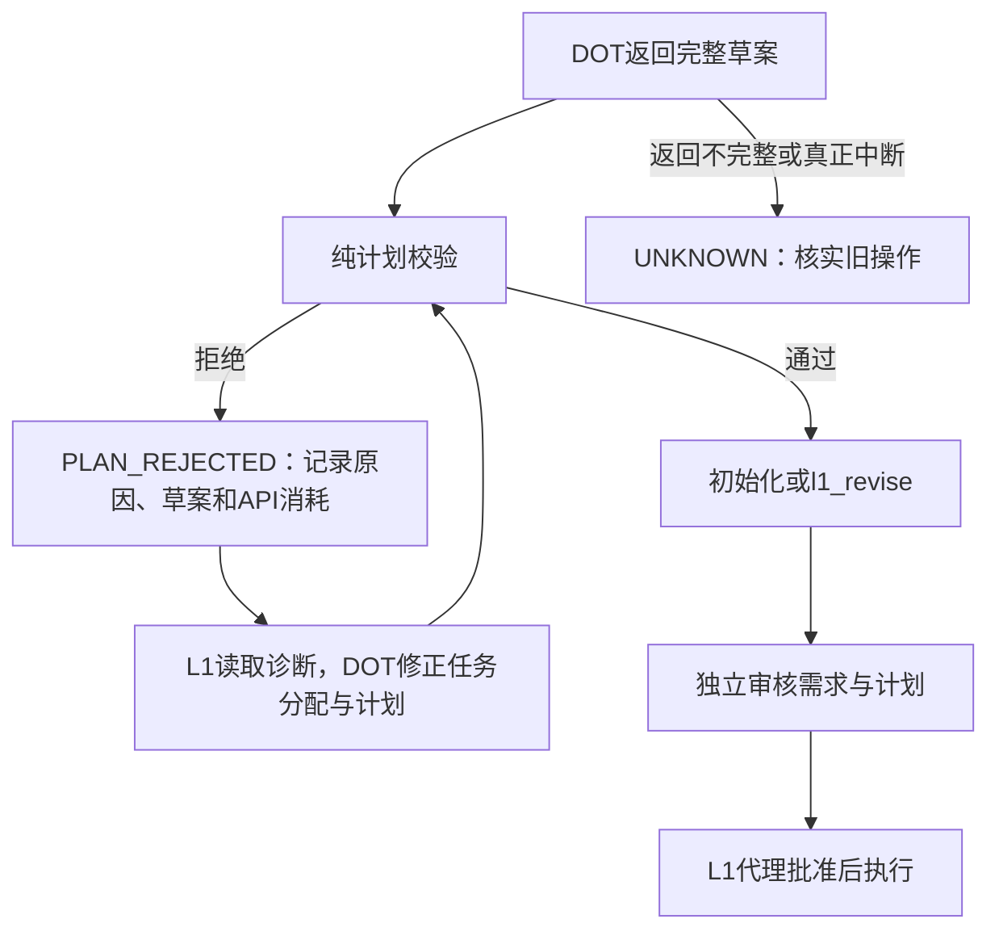

# 实现次数、计划拒绝与正常修订

3.2.2起，完整收到DOT草案后的字段、任务、路径和预算校验拒绝进入`PLAN_REJECTED`。它是一次已完成的规划操作，没有派发产品工作；API调用仍计费并累计。L1读取诊断后修正草案，不把它写成执行中断或立即结案。

## “3次”的准确含义

`implementation_attempts`是整个任务累计的L3实现派工上限，包含初次实现、后续实现任务和修复。不是每个任务各有3次，不是3轮完整研发，也不是流程中只能出现3个阶段。本版保留这项既有授权含义。

| 计划分配 | 3次实现预算的含义 |
| --- | --- |
| 1个实现任务 | 初次派工1次，最多还可修复2次，仍受其他限制 |
| 2个实现任务 | 初次派工2次，最多还可修复1次 |
| 3个实现任务 | 初次派工用满3次，没有实现修复余量 |
| 7个实现任务 | 不能在3次内完成，返回拒绝；不能自动加预算 |

`tasks`只列实际L3实现派工，建议明确写`role: implementation`；旧计划省略role仍表示implementation。任何显式test/review等role都被拒绝，不能因字段无人执行而误以为实现了角色隔离。

读码及编写注释属于相关实现任务的工作内容。构建、测试、适用HIL的执行与证据写入`verification.test_instructions`和受支持的实际测试入口；Doxygen生成使用`verification.doxygen`；独立代码、华为条款与注释语义审核使用`review_instructions`及既有合规门禁。编写测试代码与执行独立验证也须区分。

把独立验证放到正确的验证部分不会减少验收范围；不得删除AC、把独立审核塞进开发会话、伪造未具备的HIL能力，或仅合并任务名称以隐藏必要派工。若真实L3工作仍需更多独立派工，应说明预算内不可行，不能通过更改计数单位获得隐含扩权。额外工具/设备前置条件无法落实时继续使用NEEDS_INFO。

## 状态与恢复

| 结果 | 状态与动作 |
| --- | --- |
| 完整草案未通过纯校验 | PLAN_REJECTED，accepted=false，operation_status=COMPLETED_REJECTED；当前工具调用正常返回 |
| 尚缺关键事实 | NEEDS_INFO，按[事实补充指南](clarifications.md)处理 |
| 传输中断、返回不完整、进程取消、落盘失败或结果不明 | 保留UNKNOWN，不自动重放 |
| 当前额度不足（动态任务） | BUDGET_REVIEW_PENDING：L1评估、调整或申请追加授权，保留消耗 |
| 明确终止、无法取得所需授权或已有最终报告 | 继续按终态规则处理，不靠修订解锁 |

1. 初始化前使用`dot_plan`取得有效草案，再`dot_initialize`。此时`l1_revise`正常返回“尚无运行基线”，不会留下虚假中断。
2. `dot_plan`的下一次显式调用会携带上次拒绝原因和草案。相同需求可以使用新诊断修正；若模型再次给出相同无效草案，输入与诊断都没有变化，则阻止继续盲重发。每次实际API调用均按原账本计数，没有后台自动重试。
3. 已初始化的暂停任务，可用`dot_plan`重新规划后`l1_revise`，也可直接向`l1_revise`提交修正草案。未通过纯校验时不写新基线、不清除旧证据、不扣基线修订次数，也不允许继续批准旧计划。有效修订才消耗既有revisions预算并使旧批准、候选失效。
4. 新计划须覆盖剩余实现派工：`已用实现次数 + 新计划任务数 ≤ 计划实现次数上限 ≤ 原委托上限`。修订不能把已用次数变成可用次数。
5. 拒绝记录写入控制目录`planning-rejections/`，最终报告纳入历史。记录和状态持久化失败时不返回“已完成”；原在途保护仍然有效。

## 已经被旧版锁定的任务

本版修复后续规划与修订的返回路径，不自动删除旧`interrupted.json`、改写最终失败报告或重绑已确认的软件版本。旧任务必须先核对原API响应、进程、项目指纹、确认记录及剩余预算，再单独处理迁移；不能只看错误文字就解锁。更新插件不等于旧任务已恢复，也不重新授权预算。

## 验证边界

自动化验证结构、账本、状态和拒绝路径；不能证明模型总能正确识别任务角色、保留全部自然语言需求或真正完成硬件测试。独立审核和实际候选证据仍是必需条件。

3.3.0动态任务补充：实际初始派工数超出当前分配时进入BUDGET_REVIEW_PENDING，L1先评估拆分、剩余工作和资源收益，在用户上限内调整后重新规划。仅草案自身的预算字段错误仍为PLAN_REJECTED。超过用户总上限不能自动放行；具体追加授权走[动态资源流程](adaptive-resources.md)。旧固定任务保持原规则，真实UNKNOWN和最终报告不被解锁。

3.6.0另提供[未提交初始化恢复](initialization-recovery.md)，它不重放已完成的dot_plan，也不处理未完成的API。接受变化后的项目基线后需要新的规划及独立审核，费用继续累计。
